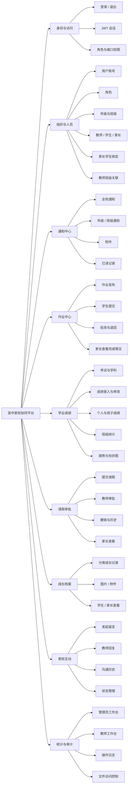
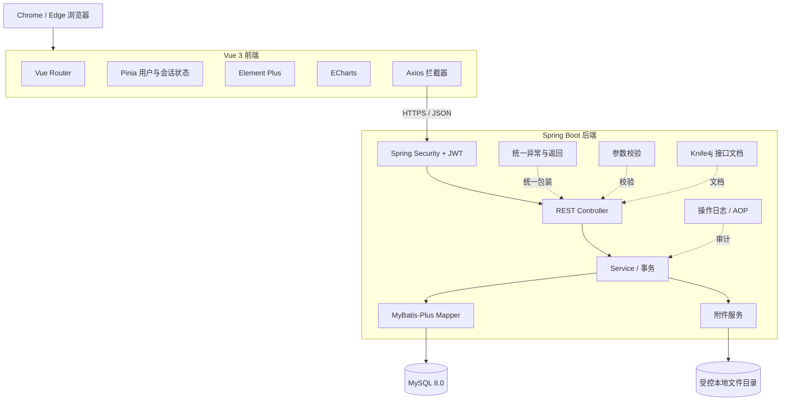
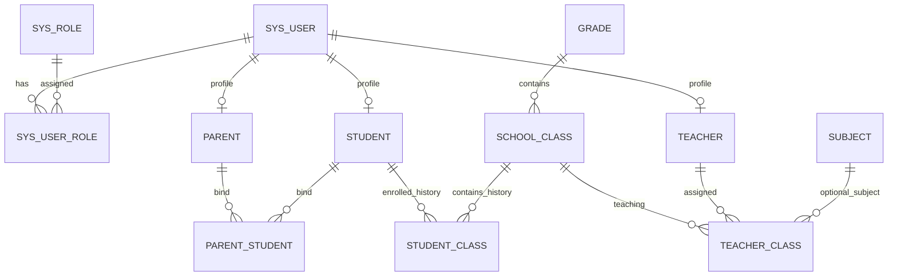
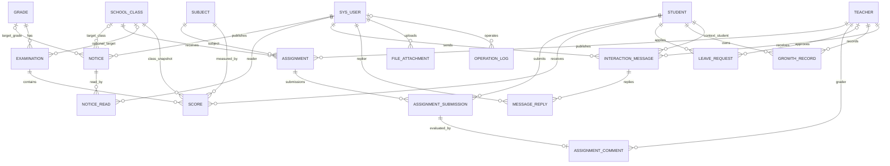
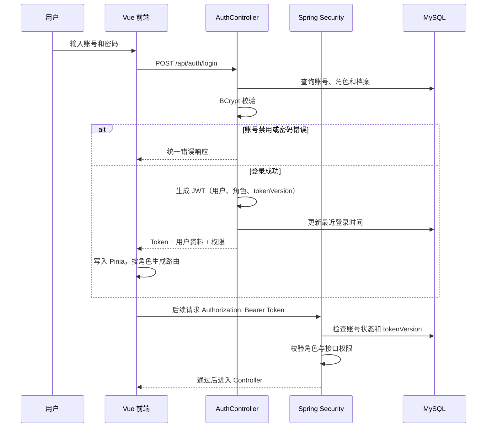
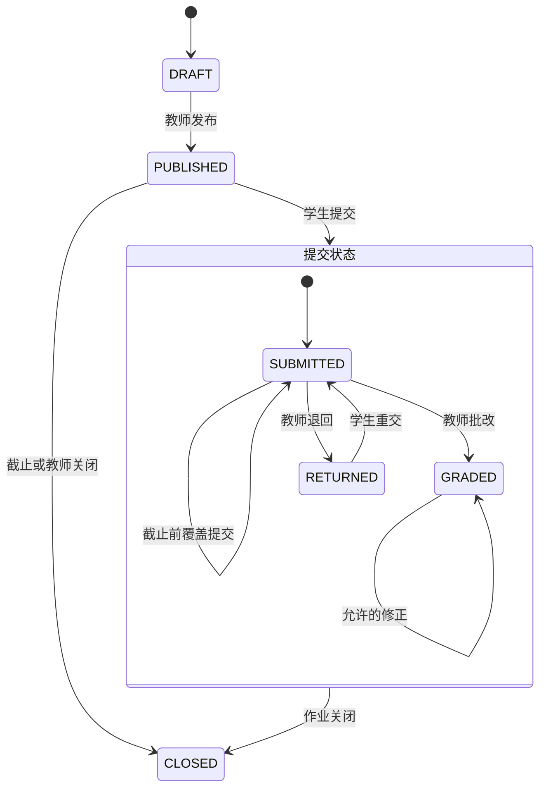
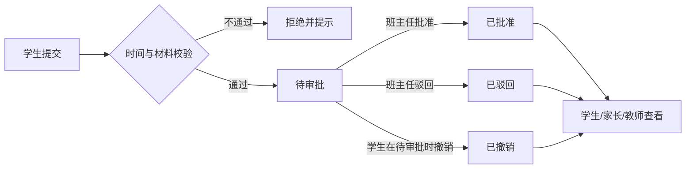

# 基于 Web 的高中家校协同智慧互通平台
## 需求分析与总体设计（设计基线 v0.1）

> 文档日期：2026-11-26  
> 当前阶段：需求分析与技术准备，不包含业务代码实现  
> 需求依据：项目总提示词  
> 工作区现状：目录为空、尚未初始化 Git、无可复用源码、无 `AGENTS.md`

---

## 0. 结论摘要

项目在技术上可行，业务范围适合采用“前后端分离的模块化单体”实现。建议先完成可验证的基础骨架，再按“身份与组织 → 通知与作业 → 成绩 → 请假与成长 → 互动与统计 → 联调验收”的顺序迭代。

本设计采用以下基线决策：

1. 前端使用 Vue 3 + TypeScript + Vite + Element Plus + Pinia + Vue Router + Axios + ECharts。
2. 后端使用 Java 17 + Spring Boot 3.x + Spring Security 6 + JWT + MyBatis-Plus + Maven + Knife4j。
3. 数据库使用 MySQL 8.0，字符集统一为 `utf8mb4`，业务表采用逻辑删除。
4. 采用模块化单体，不引入微服务、消息队列、WebSocket 等当前范围不需要的复杂度。
5. “一个通知、一份作业”默认只面向一个目标范围；如需一次发布到多个班级，后续增加投放关联表，不把班级 ID 拼接存进字段。
6. 增加 `student_class` 班级履历表。学生升年级或调班后，历史成绩、作业和统计仍能按当时班级还原。
7. 教师权限以 `teacher_class` 的有效关联为边界；班主任权限与任课教师权限继续细分，不能只判断 `TEACHER` 角色。
8. 家长数据范围以有效 `parent_student` 绑定为边界；学生只能访问自己的数据和画像。
9. 文件采用私有本地存储，通过鉴权下载接口访问，不把真实路径直接暴露给前端。
10. 建议以 14 周作为基线排期，可在 12～16 周之间根据基础项目复用程度、测试深度和演示要求调整。

当前工作区没有可审计的现成项目，因此本设计按绿地项目给出。如果后续坚持“基于完整 GitHub 项目二次开发”，应先提供仓库地址或压缩包，完成代码、许可证、依赖、构建和权限模型审计后，再调整目录与排期。不能在未读代码的情况下声称已经复用某个项目。

---

## 1. 项目范围分析

### 1.1 建设对象

系统以单所学校、单校区、高中三个年级为主要场景，连接以下四方：

- 学校管理员
- 教师
- 学生
- 家长

`ADMIN`、`TEACHER`、`STUDENT`、`PARENT` 是四个基础角色。角色编码和权限判断在后端完成，前端只根据后端返回的权限生成菜单和按钮。

### 1.2 本期范围

- Web 管理端和 Web 业务端，共用一套前端工程。
- 用户、角色、年级、班级、教师、学生、家长及关系管理。
- 校园通知和班级通知。
- 作业发布、提交、退回、批改。
- 考试、学科、成绩录入、查询和统计图表。
- 学生请假和教师审批。
- 学生成长档案。
- 家长、学生与教师之间的站内留言。
- 管理员和教师工作台统计。
- 附件上传、鉴权下载和操作日志。

### 1.3 本期不纳入范围

- 微信小程序、原生 App、微信公众号。
- WebSocket 实时聊天。
- 在线支付、排课、考勤设备接入、视频课程。
- 大规模消息推送、短信网关、邮件网关。
- 多学校 SaaS 租户体系。
- 复杂工作流引擎和可拖拽流程设计器。
- 人工智能自动批改、学情推荐等未明确需求。

### 1.4 非功能目标

| 维度 | 目标 | 验收原则 |
|---|---|---|
| 身份安全 | BCrypt 密码、JWT、禁用账号拦截 | 不在日志、响应或仓库中泄露密码和密钥 |
| 数据隔离 | 角色 + 数据归属双重校验 | 修改 URL、请求参数或记录 ID 仍无法越权 |
| 业务正确性 | 事务、唯一约束、状态机、参数校验 | 重复提交、重复成绩、非法状态流转被拒绝 |
| 可维护性 | 按业务模块分包、统一返回和异常 | 新增模块不修改大量无关代码 |
| 性能基线 | 列表分页，常用过滤字段有索引 | 以开发机测试数据量为准，核心列表无明显全表扫描 |
| 文件安全 | 白名单、大小限制、随机存储名、鉴权下载 | 未登录或无权用户不能直接读取附件 |
| 兼容性 | Chrome、Edge 最新稳定版及常见桌面分辨率 | 1366×768 起可完整操作，主要面向 1920×1080 |
| 可部署性 | 本地可运行，提供初始化脚本和部署说明 | 新环境按 README 和 SQL 可复现 |

### 1.5 关键业务假设

以下假设用于让设计可以闭环，进入编码前需要确认：

1. 每名学生、教师、家长都有一个独立 `sys_user` 账号。
2. 家长与学生绑定由管理员核验；第一期不开放“家长自助绑定并立即生效”。
3. 一个家长可绑定多个孩子，一名学生可有多个家长。
4. 请假由当前班主任审批；如班级未配置班主任，由管理员临时指定有本班关联的教师审批。
5. 任课教师只能维护自己所教学科的作业和成绩，不能审批请假或维护成长档案。
6. 班级通知由管理员、班主任或经授权的本班教师发布；发布范围必须在后端验证。
7. 同一学生对同一作业保留一条当前提交记录，允许在截止时间前覆盖提交；被退回后在允许期限内重交。
8. 成绩以“考试 + 学生 + 学科”为唯一记录，同一组合不能重复录入。
9. 本地文件存储仅用于单机验收；生产环境应改为对象存储或受控网络共享存储。

### 1.6 已确认的基线决策

- 采用绿地开发，不再以未审计的 GitHub 项目作为基础。
- 请假由学生当前班级的班主任审批。
- 班级通知允许该班所有有效任课教师发布。
- 接受增加 `student_class` 学生班级履历表。

---

## 2. 系统功能结构

### 2.1 功能结构图



### 2.2 按角色划分的页面

| 角色 | 主要页面 |
|---|---|
| 管理员 | 工作台、用户、角色、教师、学生、家长、家长绑定、年级、班级、教师任课、通知、考试、学科、数据统计、操作日志 |
| 教师 | 工作台、我的班级、班级学生、班级通知、作业、成绩、请假审批、成长档案、家校互动 |
| 学生 | 首页、校园通知、我的作业、作业提交、我的成绩、成绩分析、我的请假、成长档案、家校留言 |
| 家长 | 首页、我的孩子、校园通知、孩子成绩、孩子作业、请假记录、成长档案、家校互动 |

页面菜单由后端返回的角色和权限集合生成。前端路由守卫只用于体验控制，不能代替后端鉴权。

---

## 3. 技术架构

### 3.1 总体架构图



### 3.2 技术选型

| 层次 | 选型 | 说明 |
|---|---|---|
| 前端框架 | Vue 3 Composition API + TypeScript | 类型约束接口和表单，便于维护 |
| 构建 | Vite | 开发代理和构建 |
| UI | Element Plus | 菜单、表格、弹窗、分页、表单 |
| 状态 | Pinia | 会话、当前用户、权限、字典 |
| 路由 | Vue Router 4 | 静态路由 + `meta.roles` |
| HTTP | Axios | 统一 Token、错误提示和返回解包 |
| 图表 | ECharts | 成绩趋势、成绩柱状图、统计图 |
| 后端 | Java 17 + Spring Boot 3.x | Web、依赖注入、校验、事务 |
| 安全 | Spring Security 6 + JWT | 认证和 URL/方法级授权 |
| ORM | MyBatis-Plus | CRUD、分页、逻辑删除 |
| 文档 | Knife4j / OpenAPI | 接口联调与验收 |
| 数据库 | MySQL 8.0 | 事务型业务数据 |
| 构建 | Maven + npm | 可复现构建 |
| 部署 | Tomcat（Spring Boot 内嵌） | 前端静态资源由 Nginx 或同域静态服务承载 |

具体依赖小版本在搭建工程时锁定并提交锁文件，不使用浮动版本。升级依赖必须重新执行构建和安全测试。

### 3.3 分层职责

```text
Controller -> DTO 校验 -> Service -> Mapper -> Entity -> MySQL
                            |
                            +-> VO 组装、数据权限校验、事务、附件绑定、操作日志
```

- Controller 只负责接收请求、参数校验和返回统一结果。
- Service 负责业务状态机、数据范围、事务和跨表校验。
- Mapper 只负责数据访问，不在 SQL 中散落业务判断。
- Entity 与数据库表对应，不直接返回给前端。
- DTO 接收请求，VO 返回展示数据。
- Security 负责认证、JWT 解析和接口入口保护。
- Common 负责统一返回、异常、常量、工具和分页模型。

### 3.4 统一接口约定

成功响应：

```json
{
  "code": 200,
  "message": "操作成功",
  "data": {}
}
```

失败响应仍使用统一结构，HTTP 状态码与业务码保持一致。分页数据统一包含 `records`、`total`、`page`、`size`。

接口域建议如下：

```text
/api/auth
/api/users
/api/roles
/api/grades
/api/classes
/api/teachers
/api/students
/api/parents
/api/parent-students
/api/notices
/api/assignments
/api/exams
/api/subjects
/api/scores
/api/leaves
/api/growth-records
/api/messages
/api/dashboard
/api/files
/api/logs
```

---

## 4. 用户权限矩阵

### 4.1 表格符号

- `✓`：有权限。
- `S`：仅本人数据。
- `C`：仅本人绑定孩子或本人负责班级的数据。
- `H`：仅班主任数据范围。
- `T`：仅本人任教学科、任教班级范围。
- `—`：无权限。

### 4.2 功能权限矩阵

| 功能 | 管理员 | 教师 | 学生 | 家长 | 后端数据范围要求 |
|---|---:|---:|---:|---:|---|
| 登录、查看本人信息、修改本人密码 | ✓ | ✓ | ✓ | ✓ | 当前登录用户 |
| 用户账号增删改查、启禁用 | ✓ | — | — | — | 管理员专属 |
| 角色和用户角色管理 | ✓ | — | — | — | 管理员专属 |
| 年级、班级管理 | ✓ | C | — | — | 教师只读本人关联班级 |
| 教师信息管理 | ✓ | S | — | — | 教师只能查看/修改有限本人资料 |
| 学生信息管理 | ✓ | C | S | C | 教师按班级，学生本人，家长按有效绑定 |
| 家长信息管理 | ✓ | — | — | S | 家长只能维护本人资料 |
| 家长学生绑定 | ✓ | — | — | S | 家长可查看绑定关系，不能自行审批 |
| 教师班级任课关联 | ✓ | C | — | — | 教师只读本人关联 |
| 发布全校通知 | ✓ | — | — | — | `ADMIN` |
| 发布班级通知 | ✓ | C | — | — | 有效本班关联 |
| 通知附件上传 | ✓ | C | — | — | 发布范围权限 |
| 查看通知 | ✓ | C | C | C | 全校、本人班级或孩子班级 |
| 标记通知已读 | ✓ | ✓ | ✓ | ✓ | 可访问通知 + 用户唯一已读记录 |
| 查看通知阅读记录 | ✓ | C | — | — | 管理员全校，教师本人发布且在班范围 |
| 发布作业 | ✓ | T | — | — | 本人任教班级、学科 |
| 查看作业 | ✓ | T | C | C | 学生本人班级，家长孩子班级 |
| 提交/重交作业 | — | — | S | — | 本人且未截止，退回场景按规则 |
| 查看提交清单 | ✓ | T | — | — | 本人发布或任课范围 |
| 批改/退回作业 | ✓ | T | — | — | 本人发布或授权任课作业 |
| 查看作业完成情况 | ✓ | C | S | C | 学生本人，家长孩子 |
| 考试信息管理 | ✓ | T | — | — | 管理员全校，教师本人班级范围 |
| 学科管理 | ✓ | — | — | — | 管理员专属 |
| 成绩录入、修改 | ✓ | T | — | — | 本人任教学科和班级 |
| 成绩查询 | ✓ | C | S | C | 学生本人，家长有效绑定孩子 |
| 班级成绩统计 | ✓ | C | — | — | 本班班主任或任课范围内统计 |
| 提交请假 | — | — | S | — | 学生本人 |
| 查看请假 | ✓ | C | S | C | 教师本班，家长孩子 |
| 审批请假 | ✓ | H | — | — | 当前班级班主任 |
| 撤销请假 | — | — | S | — | 学生本人，仅待审批状态 |
| 创建成长记录 | ✓ | H | — | — | 本班班主任 |
| 查看成长档案 | ✓ | C | S | C | 学生本人，家长有效绑定孩子 |
| 发起留言 | — | — | S | C | 学生本人，家长本人及孩子 |
| 查看留言 | ✓ | C | S | C | 会话参与方或管理员审计 |
| 回复留言 | — | C | — | — | 接收教师或会话教师 |
| 管理员统计 | ✓ | — | — | — | 从数据库实时聚合 |
| 教师统计 | — | C | — | — | 本人负责班级 |
| 操作日志 | ✓ | — | — | — | 管理员专属 |
| 下载业务附件 | ✓ | C | C | C | 先校验业务资源访问权，再签发文件流 |

### 4.3 数据范围实现原则

不能仅使用 `@PreAuthorize("hasRole('TEACHER')")`。每个业务资源查询都必须增加归属条件：

- 学生访问成绩时，强制 `score.student_id = currentStudentId`。
- 家长访问成绩时，先验证 `parent_student.status = ACTIVE`，再限制 `score.student_id IN 绑定学生`。
- 教师操作班级资源时，先根据当前用户查找 `teacher`，再查有效 `teacher_class`。
- 班主任专属操作再检查 `teacher_class.relation_type = HOMEROOM`。
- 任课教师操作成绩和作业时再检查 `subject_id` 和班级关联。
- 管理员接口使用角色和权限双重校验。
- 任何根据 ID 获取详情的接口都要重新执行数据归属检查，不能依赖列表查询已过滤。
- 文件下载通过 `file_attachment.biz_type + biz_id` 找回业务资源并复用业务鉴权，不能只凭不可猜文件名放行。

建议实现一个统一的数据范围上下文：

```text
CurrentUserContext
  userId
  roles
  teacherId / studentId / parentId
  relatedClassIds
  relatedStudentIds
```

该上下文由 Service 每次根据数据库关系构造，不直接信任 JWT 中的过期班级或绑定信息。

---

## 5. 数据库 E-R 设计

### 5.1 设计说明

提示词列出的 24 张表基本覆盖业务。本设计额外增加 `student_class`，原因是学生班级会随学年变化；如果只在学生表中保存当前班级，历史成绩、历史作业和班级统计会在学生升年级后失真。

关系分为三类：

1. 账号与身份：用户、角色、教师/学生/家长档案。
2. 组织关系：年级、班级、教师任课、学生班级履历、家长绑定。
3. 业务数据：通知、作业、成绩、请假、成长、互动、附件和日志。

`file_attachment` 和 `operation_log` 是通用数据。附件使用 `biz_type + biz_id` 形成受控的多态关联；由于附件可先上传后绑定，不强制数据库外键。操作日志保留用户快照，不因账号逻辑删除而失去审计信息。

### 5.2 身份与组织关系图



### 5.3 业务关系图



### 5.4 关系基数摘要

| 关系 | 基数 | 业务约束 |
|---|---|---|
| 用户—角色 | N:N | 同一用户可有多个角色，但教师、学生、家长业务账号通常只分配一个主角色 |
| 用户—教师/学生/家长档案 | 1:0..1 | 每个档案只能绑定一个账号 |
| 家长—学生 | N:N | 通过 `parent_student`，绑定需审核状态 |
| 年级—班级 | 1:N | 同一学年内班级名称在年级下唯一 |
| 教师—班级—学科 | N:N | `SUBJECT` 关联必须带学科；`HOMEROOM` 关系不带学科 |
| 学生—班级 | N:N（含时间） | `student_class` 保存入学、离班日期，当前班级最多一条 |
| 通知—阅读记录 | 1:N | `notice_id + user_id` 唯一 |
| 作业—提交 | 1:N | `assignment_id + student_id` 唯一，保留当前提交 |
| 提交—批改 | 1:0..1 | 每份当前提交最多一条当前批改结果 |
| 考试—成绩 | 1:N | `exam_id + student_id + subject_id` 唯一 |
| 留言—回复 | 1:N | 会话参与方可读，回复按时间排序 |
| 业务资源—附件 | 1:N | `biz_type + biz_id` 逻辑关联，下载时执行资源鉴权 |

---

## 6. 数据库表结构设计

### 6.1 公共约定

除非特别说明，每张业务表均包含：

| 字段 | 类型 | 约束 | 说明 |
|---|---|---|---|
| `id` | BIGINT UNSIGNED | PK, AUTO_INCREMENT | 主键 |
| `created_at` | DATETIME(3) | NOT NULL, 默认当前时间 | 创建时间 |
| `updated_at` | DATETIME(3) | NOT NULL, 更新时刷新 | 更新时间 |
| `deleted` | TINYINT | NOT NULL DEFAULT 0 | 逻辑删除；日志、阅读记录等只追加数据可不使用 |

时间统一由后端或数据库按同一时区生成。状态字段使用短字符串枚举或受控字典值，避免难以理解的魔法数字。金额不涉及；成绩使用 `DECIMAL`。

索引原则：

- 所有外键逻辑字段均有普通索引。
- 唯一业务组合建立唯一索引。
- 列表常用过滤字段与排序字段建联合索引。
- 逻辑删除字段放在常用查询索引的末端，避免查询条件顺序失配。
- 不在低选择性字段上单独堆叠大量索引。

### 6.2 身份、组织与人员

#### `sys_user` 用户账号

| 字段 | 类型 | 约束 | 说明 |
|---|---|---|---|
| `id` | BIGINT UNSIGNED | PK | 主键 |
| `username` | VARCHAR(50) | NOT NULL, UNIQUE | 登录名 |
| `password_hash` | VARCHAR(100) | NOT NULL | BCrypt 哈希 |
| `real_name` | VARCHAR(50) | NOT NULL | 姓名 |
| `phone` | VARCHAR(20) | NULL, UNIQUE | 手机号 |
| `email` | VARCHAR(100) | NULL | 邮箱 |
| `avatar_file_id` | BIGINT UNSIGNED | NULL | 头像附件 |
| `status` | VARCHAR(20) | NOT NULL | `ENABLED` / `DISABLED` |
| `token_version` | INT UNSIGNED | NOT NULL DEFAULT 0 | JWT 失效版本 |
| `last_login_at` | DATETIME(3) | NULL | 最近登录 |
| 公共字段 | — | — | 含逻辑删除 |

索引：`uk_username`、`uk_phone`、`idx_status`。手机号可为空，MySQL 唯一索引允许多个 `NULL`。

#### `sys_role` 角色

| 字段 | 类型 | 约束 | 说明 |
|---|---|---|---|
| `id` | BIGINT UNSIGNED | PK | 主键 |
| `role_code` | VARCHAR(30) | NOT NULL, UNIQUE | `ADMIN` / `TEACHER` / `STUDENT` / `PARENT` |
| `role_name` | VARCHAR(50) | NOT NULL | 展示名称 |
| `description` | VARCHAR(255) | NULL | 说明 |
| `status` | VARCHAR(20) | NOT NULL | 启用状态 |
| 公共字段 | — | — | 系统角色不建议物理删除 |

#### `sys_user_role` 用户角色关联

| 字段 | 类型 | 约束 | 说明 |
|---|---|---|---|
| `id` | BIGINT UNSIGNED | PK | 主键 |
| `user_id` | BIGINT UNSIGNED | NOT NULL, FK 逻辑关联 | 用户 |
| `role_id` | BIGINT UNSIGNED | NOT NULL, FK 逻辑关联 | 角色 |
| `created_at` | DATETIME(3) | NOT NULL | 分配时间 |
| `created_by` | BIGINT UNSIGNED | NULL | 操作者 |

唯一索引：`uk_user_role (user_id, role_id)`。

#### `teacher` 教师档案

| 字段 | 类型 | 约束 | 说明 |
|---|---|---|---|
| `id` | BIGINT UNSIGNED | PK | 教师业务 ID |
| `user_id` | BIGINT UNSIGNED | NOT NULL, UNIQUE | 账号 |
| `employee_no` | VARCHAR(30) | NOT NULL, UNIQUE | 工号 |
| `gender` | VARCHAR(10) | NULL | 性别 |
| `title` | VARCHAR(50) | NULL | 职称 |
| `specialty` | VARCHAR(100) | NULL | 专业或主要学科 |
| `hire_date` | DATE | NULL | 入职日期 |
| `office_phone` | VARCHAR(20) | NULL | 办公电话 |
| `status` | VARCHAR(20) | NOT NULL | 在职状态 |
| 公共字段 | — | — | 含逻辑删除 |

#### `student` 学生档案

| 字段 | 类型 | 约束 | 说明 |
|---|---|---|---|
| `id` | BIGINT UNSIGNED | PK | 学生业务 ID |
| `user_id` | BIGINT UNSIGNED | NOT NULL, UNIQUE | 账号 |
| `student_no` | VARCHAR(30) | NOT NULL, UNIQUE | 学号 |
| `gender` | VARCHAR(10) | NULL | 性别 |
| `birth_date` | DATE | NULL | 出生日期 |
| `enrollment_date` | DATE | NULL | 入学日期 |
| `status` | VARCHAR(20) | NOT NULL | 在读/毕业/停用 |
| 公共字段 | — | — | 含逻辑删除 |

#### `parent` 家长档案

| 字段 | 类型 | 约束 | 说明 |
|---|---|---|---|
| `id` | BIGINT UNSIGNED | PK | 家长业务 ID |
| `user_id` | BIGINT UNSIGNED | NOT NULL, UNIQUE | 账号 |
| `gender` | VARCHAR(10) | NULL | 性别 |
| `occupation` | VARCHAR(100) | NULL | 职业 |
| `emergency_contact` | VARCHAR(20) | NULL | 紧急联系电话 |
| `status` | VARCHAR(20) | NOT NULL | 账号档案状态 |
| 公共字段 | — | — | 含逻辑删除 |

#### `parent_student` 家长学生绑定

| 字段 | 类型 | 约束 | 说明 |
|---|---|---|---|
| `id` | BIGINT UNSIGNED | PK | 主键 |
| `parent_id` | BIGINT UNSIGNED | NOT NULL | 家长 |
| `student_id` | BIGINT UNSIGNED | NOT NULL | 学生 |
| `relationship` | VARCHAR(20) | NOT NULL | 父亲/母亲/监护人 |
| `is_primary` | TINYINT | NOT NULL DEFAULT 0 | 主要联系人 |
| `status` | VARCHAR(20) | NOT NULL | `PENDING` / `ACTIVE` / `REVOKED` |
| `verified_by` | BIGINT UNSIGNED | NULL | 核验管理员 |
| `verified_at` | DATETIME(3) | NULL | 核验时间 |
| `created_at` / `updated_at` | DATETIME(3) | NOT NULL | 关系时间 |

唯一索引：`uk_parent_student (parent_id, student_id)`。普通索引：`idx_student_status (student_id, status)`、`idx_parent_status`。

#### `grade` 年级

| 字段 | 类型 | 约束 | 说明 |
|---|---|---|---|
| `id` | BIGINT UNSIGNED | PK | 主键 |
| `grade_name` | VARCHAR(30) | NOT NULL, UNIQUE | 高一、高二、高三 |
| `grade_level` | TINYINT | NOT NULL | 1、2、3 |
| `sort_order` | INT | NOT NULL DEFAULT 0 | 展示顺序 |
| `status` | VARCHAR(20) | NOT NULL | 启用状态 |
| 公共字段 | — | — | 含逻辑删除 |

#### `school_class` 班级

| 字段 | 类型 | 约束 | 说明 |
|---|---|---|---|
| `id` | BIGINT UNSIGNED | PK | 主键 |
| `grade_id` | BIGINT UNSIGNED | NOT NULL | 年级 |
| `class_name` | VARCHAR(50) | NOT NULL | 如“1班” |
| `academic_year` | VARCHAR(20) | NOT NULL | 如“2026-2027” |
| `graduation_year` | SMALLINT | NULL | 毕业年份 |
| `status` | VARCHAR(20) | NOT NULL | 启用/结业 |
| 公共字段 | — | — | 含逻辑删除 |

唯一索引：`uk_class_grade_year (grade_id, class_name, academic_year)`。普通索引：`idx_academic_year`。

#### `teacher_class` 教师班级关联

| 字段 | 类型 | 约束 | 说明 |
|---|---|---|---|
| `id` | BIGINT UNSIGNED | PK | 主键 |
| `teacher_id` | BIGINT UNSIGNED | NOT NULL | 教师 |
| `class_id` | BIGINT UNSIGNED | NOT NULL | 班级 |
| `subject_id` | BIGINT UNSIGNED | NULL | 任教学科；班主任记录可为空 |
| `relation_type` | VARCHAR(20) | NOT NULL | `HOMEROOM` / `SUBJECT` |
| `start_date` | DATE | NOT NULL | 开始日期 |
| `end_date` | DATE | NULL | 结束日期 |
| `status` | VARCHAR(20) | NOT NULL | `ACTIVE` / `ENDED` |
| 公共字段 | — | — | 含逻辑删除 |

业务唯一规则：

- 同一教师、班级、学科、关系类型只允许一条有效记录。
- 同一班级在有效期内最多一个班主任。
- `HOMEROOM` 必须 `subject_id IS NULL`。
- `SUBJECT` 必须有不重复的学科。

索引：`idx_teacher_status`、`idx_class_status`、`idx_subject`。

#### `student_class` 学生班级履历（补充表）

| 字段 | 类型 | 约束 | 说明 |
|---|---|---|---|
| `id` | BIGINT UNSIGNED | PK | 主键 |
| `student_id` | BIGINT UNSIGNED | NOT NULL | 学生 |
| `class_id` | BIGINT UNSIGNED | NOT NULL | 班级 |
| `start_date` | DATE | NOT NULL | 入班日期 |
| `end_date` | DATE | NULL | 离班日期 |
| `status` | VARCHAR(20) | NOT NULL | `CURRENT` / `ENDED` |
| 公共字段 | — | — | 含逻辑删除 |

唯一索引：`uk_student_class_date (student_id, class_id, start_date)`。普通索引：`idx_class_status`、`idx_student_status`。同一学生当前班级最多一条，由事务和锁保证。

### 6.3 通知

#### `notice` 通知

| 字段 | 类型 | 约束 | 说明 |
|---|---|---|---|
| `id` | BIGINT UNSIGNED | PK | 主键 |
| `publisher_id` | BIGINT UNSIGNED | NOT NULL | 发布用户 |
| `scope_type` | VARCHAR(20) | NOT NULL | `ALL` / `GRADE` / `CLASS` |
| `grade_id` | BIGINT UNSIGNED | NULL | 年级范围 |
| `class_id` | BIGINT UNSIGNED | NULL | 班级范围 |
| `title` | VARCHAR(200) | NOT NULL | 标题 |
| `content` | LONGTEXT | NOT NULL | 正文，展示前做安全清洗 |
| `status` | VARCHAR(20) | NOT NULL | `DRAFT` / `PUBLISHED` / `WITHDRAWN` |
| `published_at` | DATETIME(3) | NULL | 发布时间 |
| `withdrawn_at` | DATETIME(3) | NULL | 撤回时间 |
| 公共字段 | — | — | 含逻辑删除 |

索引：`idx_status_publish (status, published_at)`、`idx_class_publish`、`idx_grade_publish`。

#### `notice_read` 通知阅读

| 字段 | 类型 | 约束 | 说明 |
|---|---|---|---|
| `id` | BIGINT UNSIGNED | PK | 主键 |
| `notice_id` | BIGINT UNSIGNED | NOT NULL | 通知 |
| `user_id` | BIGINT UNSIGNED | NOT NULL | 阅读用户 |
| `read_at` | DATETIME(3) | NOT NULL | 阅读时间 |

唯一索引：`uk_notice_user (notice_id, user_id)`。普通索引：`idx_user_read_at (user_id, read_at)`。

### 6.4 作业

#### `assignment` 作业

| 字段 | 类型 | 约束 | 说明 |
|---|---|---|---|
| `id` | BIGINT UNSIGNED | PK | 主键 |
| `class_id` | BIGINT UNSIGNED | NOT NULL | 所属班级 |
| `teacher_id` | BIGINT UNSIGNED | NOT NULL | 发布教师 |
| `subject_id` | BIGINT UNSIGNED | NOT NULL | 学科 |
| `title` | VARCHAR(200) | NOT NULL | 标题 |
| `content` | LONGTEXT | NOT NULL | 作业要求 |
| `deadline` | DATETIME(3) | NOT NULL | 截止时间 |
| `max_score` | DECIMAL(6,2) | NULL | 满分，可为空 |
| `status` | VARCHAR(20) | NOT NULL | `DRAFT` / `PUBLISHED` / `CLOSED` |
| `published_at` | DATETIME(3) | NULL | 发布时间 |
| 公共字段 | — | — | 含逻辑删除 |

索引：`idx_class_status_deadline (class_id, status, deadline)`、`idx_teacher_status`。

#### `assignment_submission` 作业提交

| 字段 | 类型 | 约束 | 说明 |
|---|---|---|---|
| `id` | BIGINT UNSIGNED | PK | 主键 |
| `assignment_id` | BIGINT UNSIGNED | NOT NULL | 作业 |
| `student_id` | BIGINT UNSIGNED | NOT NULL | 学生 |
| `content` | LONGTEXT | NULL | 文字内容 |
| `status` | VARCHAR(20) | NOT NULL | `SUBMITTED` / `GRADED` / `RETURNED` |
| `attempt_count` | INT UNSIGNED | NOT NULL DEFAULT 1 | 提交次数 |
| `submitted_at` | DATETIME(3) | NOT NULL | 当前提交时间 |
| `returned_at` | DATETIME(3) | NULL | 退回时间 |
| `return_reason` | VARCHAR(500) | NULL | 退回原因 |
| `version` | INT UNSIGNED | NOT NULL DEFAULT 0 | 乐观锁 |
| 公共字段 | — | — | 含更新时间 |

`UNSUBMITTED` 不单独插入占位行，由“作业可见但左连接无提交记录”推导。唯一索引：`uk_assignment_student (assignment_id, student_id)`。普通索引：`idx_student_status`。

#### `assignment_comment` 作业批改

| 字段 | 类型 | 约束 | 说明 |
|---|---|---|---|
| `id` | BIGINT UNSIGNED | PK | 主键 |
| `submission_id` | BIGINT UNSIGNED | NOT NULL, UNIQUE | 当前提交 |
| `teacher_id` | BIGINT UNSIGNED | NOT NULL | 批改教师 |
| `score` | DECIMAL(6,2) | NULL | 成绩 |
| `comment` | TEXT | NULL | 评语 |
| `graded_at` | DATETIME(3) | NOT NULL | 批改时间 |
| 公共字段 | — | — | 含更新时间 |

批改历史若后续成为需求，可改为多条记录并增加版本号；第一期保留当前结果。

### 6.5 考试与成绩

#### `subject` 学科

| 字段 | 类型 | 约束 | 说明 |
|---|---|---|---|
| `id` | BIGINT UNSIGNED | PK | 主键 |
| `subject_code` | VARCHAR(30) | NOT NULL, UNIQUE | 如 `MATH` |
| `subject_name` | VARCHAR(50) | NOT NULL, UNIQUE | 数学 |
| `default_full_score` | DECIMAL(6,2) | NOT NULL | 默认满分 |
| `sort_order` | INT | NOT NULL DEFAULT 0 | 展示顺序 |
| `status` | VARCHAR(20) | NOT NULL | 启用状态 |
| 公共字段 | — | — | 含逻辑删除 |

#### `examination` 考试

| 字段 | 类型 | 约束 | 说明 |
|---|---|---|---|
| `id` | BIGINT UNSIGNED | PK | 主键 |
| `name` | VARCHAR(150) | NOT NULL | 考试名称 |
| `exam_type` | VARCHAR(30) | NOT NULL | 月考、期中、期末等 |
| `grade_id` | BIGINT UNSIGNED | NOT NULL | 所属年级 |
| `class_id` | BIGINT UNSIGNED | NULL | 班级范围；空表示年级范围 |
| `academic_year` | VARCHAR(20) | NOT NULL | 学年 |
| `term` | VARCHAR(20) | NOT NULL | 学期 |
| `exam_date` | DATE | NOT NULL | 考试日期 |
| `status` | VARCHAR(20) | NOT NULL | `DRAFT` / `PUBLISHED` / `ARCHIVED` |
| `created_by` | BIGINT UNSIGNED | NOT NULL | 创建用户 |
| 公共字段 | — | — | 含逻辑删除 |

索引：`idx_grade_date`、`idx_class_date`、`idx_term`。

#### `score` 成绩

| 字段 | 类型 | 约束 | 说明 |
|---|---|---|---|
| `id` | BIGINT UNSIGNED | PK | 主键 |
| `exam_id` | BIGINT UNSIGNED | NOT NULL | 考试 |
| `student_id` | BIGINT UNSIGNED | NOT NULL | 学生 |
| `subject_id` | BIGINT UNSIGNED | NOT NULL | 学科 |
| `class_id` | BIGINT UNSIGNED | NOT NULL | 考试时班级快照 |
| `score` | DECIMAL(6,2) | NULL | 分数；缺席时可为空 |
| `is_absent` | TINYINT | NOT NULL DEFAULT 0 | 是否缺考 |
| `rank_in_class` | INT | NULL | 可计算缓存，非权威源 |
| `remark` | VARCHAR(255) | NULL | 备注 |
| `entered_by` | BIGINT UNSIGNED | NOT NULL | 首次录入教师 |
| `updated_by` | BIGINT UNSIGNED | NULL | 最近修改者 |
| 公共字段 | — | — | 含更新时间 |

唯一索引：`uk_exam_student_subject (exam_id, student_id, subject_id)`。普通索引：`idx_exam_class_subject (exam_id, class_id, subject_id)`、`idx_student_exam (student_id, exam_id)`。

成绩统计原则上实时聚合。`rank_in_class` 可作为缓存，但必须由同一事务重算，不能允许手工修改为权威排名。

### 6.6 请假

#### `leave_request` 请假申请

| 字段 | 类型 | 约束 | 说明 |
|---|---|---|---|
| `id` | BIGINT UNSIGNED | PK | 主键 |
| `student_id` | BIGINT UNSIGNED | NOT NULL | 申请学生 |
| `class_id` | BIGINT UNSIGNED | NOT NULL | 申请时班级快照 |
| `leave_type` | VARCHAR(30) | NOT NULL | 病假、事假等 |
| `start_at` | DATETIME(3) | NOT NULL | 开始时间 |
| `end_at` | DATETIME(3) | NOT NULL | 结束时间 |
| `reason` | TEXT | NOT NULL | 原因 |
| `status` | VARCHAR(20) | NOT NULL | `PENDING` / `APPROVED` / `REJECTED` / `CANCELLED` |
| `approver_teacher_id` | BIGINT UNSIGNED | NULL | 审批教师 |
| `approved_at` | DATETIME(3) | NULL | 审批时间 |
| `approval_opinion` | VARCHAR(500) | NULL | 审批意见 |
| `cancelled_at` | DATETIME(3) | NULL | 撤销时间 |
| `version` | INT UNSIGNED | NOT NULL DEFAULT 0 | 并发审批控制 |
| 公共字段 | — | — | 含更新时间 |

索引：`idx_student_start`、`idx_class_status_start`、`idx_approver_approved`。

业务校验：`end_at > start_at`；同一学生存在时间重叠的待审批或已批准记录时拒绝新建；仅 `PENDING` 可撤销；仅 `PENDING` 可审批；非当前班主任不能审批。

### 6.7 成长档案

#### `growth_record` 成长记录

| 字段 | 类型 | 约束 | 说明 |
|---|---|---|---|
| `id` | BIGINT UNSIGNED | PK | 主键 |
| `student_id` | BIGINT UNSIGNED | NOT NULL | 学生 |
| `class_id` | BIGINT UNSIGNED | NOT NULL | 记录时班级快照 |
| `category` | VARCHAR(30) | NOT NULL | 学习、德育、活动、荣誉、综合评价 |
| `title` | VARCHAR(200) | NOT NULL | 标题 |
| `content` | LONGTEXT | NOT NULL | 记录内容 |
| `occurred_at` | DATE | NOT NULL | 发生日期 |
| `recorder_teacher_id` | BIGINT UNSIGNED | NOT NULL | 记录教师 |
| `visible_to_parent` | TINYINT | NOT NULL DEFAULT 1 | 家长可见 |
| 公共字段 | — | — | 含逻辑删除 |

索引：`idx_student_category_date (student_id, category, occurred_at)`、`idx_recorder_date`。

### 6.8 家校互动

#### `interaction_message` 留言会话

| 字段 | 类型 | 约束 | 说明 |
|---|---|---|---|
| `id` | BIGINT UNSIGNED | PK | 主键 |
| `sender_user_id` | BIGINT UNSIGNED | NOT NULL | 发起人 |
| `sender_role` | VARCHAR(20) | NOT NULL | `STUDENT` / `PARENT` |
| `student_id` | BIGINT UNSIGNED | NOT NULL | 涉及学生 |
| `receiver_teacher_id` | BIGINT UNSIGNED | NOT NULL | 接收教师 |
| `subject` | VARCHAR(200) | NOT NULL | 主题 |
| `content` | TEXT | NOT NULL | 正文 |
| `status` | VARCHAR(20) | NOT NULL | `UNREAD` / `READ` / `REPLIED` / `CLOSED` |
| `last_reply_at` | DATETIME(3) | NULL | 最近回复 |
| `closed_at` | DATETIME(3) | NULL | 关闭时间 |
| 公共字段 | — | — | 含逻辑删除 |

索引：`idx_receiver_status (receiver_teacher_id, status)`、`idx_sender`、`idx_student`。

#### `message_reply` 留言回复

| 字段 | 类型 | 约束 | 说明 |
|---|---|---|---|
| `id` | BIGINT UNSIGNED | PK | 主键 |
| `message_id` | BIGINT UNSIGNED | NOT NULL | 会话 |
| `replier_user_id` | BIGINT UNSIGNED | NOT NULL | 回复用户 |
| `replier_role` | VARCHAR(20) | NOT NULL | 回复角色 |
| `content` | TEXT | NOT NULL | 回复正文 |
| `created_at` | DATETIME(3) | NOT NULL | 回复时间 |

普通索引：`idx_message_created (message_id, created_at)`。

### 6.9 附件与审计

#### `file_attachment` 附件

| 字段 | 类型 | 约束 | 说明 |
|---|---|---|---|
| `id` | BIGINT UNSIGNED | PK | 主键 |
| `uploader_user_id` | BIGINT UNSIGNED | NOT NULL | 上传者 |
| `biz_type` | VARCHAR(30) | NULL | `NOTICE` / `ASSIGNMENT` / `SUBMISSION` / `LEAVE` / `GROWTH` |
| `biz_id` | BIGINT UNSIGNED | NULL | 业务记录 |
| `storage_key` | VARCHAR(255) | NOT NULL, UNIQUE | 服务器内部随机相对路径 |
| `original_name` | VARCHAR(255) | NOT NULL | 原始文件名 |
| `extension` | VARCHAR(20) | NOT NULL | 规范化扩展名 |
| `mime_type` | VARCHAR(100) | NOT NULL | 服务端检测类型 |
| `file_size` | BIGINT UNSIGNED | NOT NULL | 字节数 |
| `sha256` | CHAR(64) | NULL | 完整性摘要 |
| `status` | VARCHAR(20) | NOT NULL | `TEMP` / `BOUND` / `DELETED` |
| 公共字段 | — | — | 含逻辑删除 |

普通索引：`idx_biz (biz_type, biz_id)`、`idx_uploader_created`。

上传时先产生 `TEMP` 记录，业务保存时在同一事务中绑定并改为 `BOUND`。下载时先校验业务访问权限。文件扩展名白名单、文件大小上限、随机文件名、路径穿越检查和响应头必须同时实施。

#### `operation_log` 操作日志

| 字段 | 类型 | 约束 | 说明 |
|---|---|---|---|
| `id` | BIGINT UNSIGNED | PK | 主键 |
| `user_id` | BIGINT UNSIGNED | NULL | 操作者 ID |
| `username_snapshot` | VARCHAR(50) | NULL | 用户快照 |
| `role_snapshot` | VARCHAR(100) | NULL | 角色快照 |
| `module` | VARCHAR(50) | NOT NULL | 模块 |
| `operation` | VARCHAR(100) | NOT NULL | 操作名称 |
| `http_method` | VARCHAR(10) | NULL | HTTP 方法 |
| `request_uri` | VARCHAR(255) | NULL | 请求路径 |
| `request_params` | TEXT | NULL | 脱敏后的参数摘要 |
| `result_code` | VARCHAR(30) | NULL | 结果 |
| `client_ip` | VARCHAR(64) | NULL | IP |
| `user_agent` | VARCHAR(500) | NULL | 客户端 |
| `duration_ms` | BIGINT | NULL | 耗时 |
| `created_at` | DATETIME(3) | NOT NULL | 时间 |

索引：`idx_user_created`、`idx_module_created`、`idx_result_created`。日志不得记录密码、JWT、身份证号、完整附件内容等敏感信息。

---

## 7. 前后端项目目录结构

如果最终采用现有 GitHub 项目，应优先保留其成熟目录；下面是当前无基础代码时的推荐结构。

```text
基于Web的高中家校协同智慧互通平台/
├─ README.md
├─ .gitignore
├─ .editorconfig
├─ docs/
│  ├─ 01-需求分析与总体设计.md
│  ├─ 02-数据库设计.md
│  ├─ 03-接口文档.md
│  ├─ 04-部署说明.md
│  └─ 05-测试记录.md
├─ database/
│  ├─ 01_schema.sql
│  ├─ 02_init_data.sql
│  └─ 03_test_data.sql
├─ frontend/
│  ├─ package.json
│  ├─ vite.config.ts
│  ├─ tsconfig.json
│  ├─ .env.development
│  ├─ .env.production
│  └─ src/
│     ├─ main.ts
│     ├─ App.vue
│     ├─ api/
│     │  ├─ http.ts
│     │  ├─ auth.ts
│     │  ├─ user.ts
│     │  ├─ organization.ts
│     │  ├─ notice.ts
│     │  ├─ assignment.ts
│     │  ├─ score.ts
│     │  ├─ leave.ts
│     │  ├─ growth.ts
│     │  ├─ message.ts
│     │  └─ dashboard.ts
│     ├─ assets/
│     ├─ components/
│     │  ├─ common/
│     │  ├─ charts/
│     │  └─ business/
│     ├─ layouts/
│     │  ├─ MainLayout.vue
│     │  ├─ SidebarMenu.vue
│     │  └─ HeaderBar.vue
│     ├─ router/
│     │  ├─ index.ts
│     │  ├─ guards.ts
│     │  └─ routes/
│     ├─ stores/
│     │  ├─ auth.ts
│     │  ├─ permission.ts
│     │  └─ dictionary.ts
│     ├─ styles/
│     ├─ types/
│     ├─ utils/
│     └─ views/
│        ├─ auth/
│        ├─ admin/
│        │  ├─ dashboard/
│        │  ├─ users/
│        │  ├─ roles/
│        │  ├─ teachers/
│        │  ├─ students/
│        │  ├─ parents/
│        │  ├─ grades/
│        │  ├─ classes/
│        │  └─ logs/
│        ├─ teacher/
│        │  ├─ dashboard/
│        │  ├─ classes/
│        │  ├─ notices/
│        │  ├─ assignments/
│        │  ├─ scores/
│        │  ├─ leaves/
│        │  ├─ growth/
│        │  └─ messages/
│        ├─ student/
│        │  ├─ dashboard/
│        │  ├─ notices/
│        │  ├─ assignments/
│        │  ├─ scores/
│        │  ├─ leaves/
│        │  ├─ growth/
│        │  └─ messages/
│        └─ parent/
│           ├─ dashboard/
│           ├─ children/
│           ├─ notices/
│           ├─ scores/
│           ├─ assignments/
│           ├─ leaves/
│           ├─ growth/
│           └─ messages/
├─ backend/
│  ├─ pom.xml
│  ├─ .mvn/
│  └─ src/
│     ├─ main/
│     │  ├─ java/com/example/homeschool/
│     │  │  ├─ HomeSchoolApplication.java
│     │  │  ├─ common/
│     │  │  │  ├─ result/
│     │  │  │  ├─ exception/
│     │  │  │  ├─ page/
│     │  │  │  └─ util/
│     │  │  ├─ config/
│     │  │  ├─ security/
│     │  │  ├─ module/
│     │  │  │  ├─ auth/
│     │  │  │  ├─ user/
│     │  │  │  ├─ organization/
│     │  │  │  ├─ notice/
│     │  │  │  ├─ assignment/
│     │  │  │  ├─ score/
│     │  │  │  ├─ leave/
│     │  │  │  ├─ growth/
│     │  │  │  ├─ interaction/
│     │  │  │  ├─ file/
│     │  │  │  ├─ dashboard/
│     │  │  │  └─ log/
│     │  │  └─ ...
│     │  └─ resources/
│     │     ├─ application.yml
│     │     ├─ application-dev.yml
│     │     ├─ application-prod.yml
│     │     └─ mapper/
│     └─ test/
│        └─ java/com/example/homeschool/
├─ storage/
│  ├─ upload/          # 不提交到 Git
│  ├─ temp/            # 不提交到 Git
│  └─ .gitkeep
└─ scripts/
   ├─ dev.ps1
   ├─ build.ps1
   └─ init-db.ps1
```

每个后端业务模块内部保持：

```text
module/notice/
├─ controller/
├─ service/
├─ service/impl/
├─ mapper/
├─ entity/
├─ dto/
└─ vo/
```

不建议把所有 Controller、Service、Mapper 分别集中到巨型目录，否则模块边界会快速失控。

---

## 8. 核心业务流程

### 8.1 登录与请求鉴权



退出时前端清除本地会话，后端递增当前用户 `token_version` 或采用受控黑名单使已签发 Token 失效。禁用账号、重置密码同样需要让旧 Token 失效。

### 8.2 通知发布与已读

1. 管理员或班级教师创建草稿。
2. 后端校验 `scope_type`：管理员可 `ALL/GRADE/CLASS`，教师仅 `CLASS` 且必须是有效本班关联。
3. 发布前校验标题、正文、范围和附件归属。
4. 发布后记录 `published_at`，通知出现在有范围权限用户的列表中。
5. 用户打开详情时，按 `notice_id + user_id` 幂等写入 `notice_read`。
6. 教师只能查看自己发布通知的阅读记录；管理员可查看全校。
7. 撤回后不再出现在普通列表，但历史阅读记录保留。

状态：`DRAFT -> PUBLISHED -> WITHDRAWN`。已撤回通知不允许直接重新发布，应复制为新通知或通过明确恢复规则处理。

### 8.3 作业发布、提交与批改



关键规则：

- 教师只能给本人任教的班级和学科发布作业。
- 学生只能看到本人当前班级在可见时间范围内的作业。
- 截止前允许覆盖提交，保留 `attempt_count`。
- 截止后默认禁止提交；被退回且教师明确允许重交时例外。
- 提交附件必须先验证属于当前学生且状态为临时或当前提交。
- 批改分数不能超过作业满分；状态为 `GRADED` 后学生只能看到批改结果。
- 列表查询通过左连接区分未提交、已提交、已批改、已退回。

### 8.4 成绩录入与查询

1. 管理员维护考试和学科；教师可在本班范围创建允许的考试。
2. 教师录入成绩前，后端校验考试范围、班级关联和学科关联。
3. 同一考试、学生、学科使用唯一约束防重。
4. 校验分数在 `0..满分` 范围内；缺考必须与分数互斥。
5. 提交事务内保存成绩、班级快照和操作日志。
6. 学生查询只使用本人 ID；家长查询先验证绑定；教师只聚合本班数据。
7. 趋势图按考试日期排序，学科柱状图按当前考试或指定考试统计。
8. 平均分、最高分、最低分和提交率均实时从数据库聚合。

### 8.5 请假审批



审批必须使用乐观锁或条件更新，避免两个请求同时审批成功。审批人、审批时间和意见必须持久化。

### 8.6 家校留言

1. 家长或学生选择接收教师并发起留言，必须提供涉及学生。
2. 后端校验家长与学生的有效绑定，或学生本人身份。
3. 校验接收教师与学生的班级存在有效关联。
4. 教师打开会话后将状态更新为已读；回复后更新为已回复并记录最近回复时间。
5. 会话双方和管理员审计视角可查看历史；其他人不能凭会话 ID 访问。
6. 不实现实时推送，通过刷新或轮询未读数量满足本期需要。

### 8.7 附件上传与下载

1. 前端请求上传，后端校验登录状态、扩展名、大小和 MIME。
2. 文件以随机 `storage_key` 写入私有目录，记录元数据和上传者。
3. 业务保存时在同一事务中校验临时附件归属并绑定 `biz_type + biz_id`。
4. 下载请求只传附件 ID，不直接暴露磁盘路径。
5. 后端先根据业务资源执行数据权限检查，再读取文件。
6. 响应设置 `Content-Disposition: attachment` 和安全 MIME，防止浏览器错误执行上传内容。

---

## 9. 14 周开发计划

以下计划以 1 名全栈开发者为基线，包含联调和文档。若基础项目成熟、测试范围较小，可压缩到 12 周；若无现成框架或增加复杂演示，应使用 16 周。

| 周次 | 阶段与目标 | 主要交付物 | 验收门槛 |
|---|---|---|---|
| 第 1 周 | 需求冻结与工程准备 | 需求基线、ER 定稿、目录结构、前后端空工程、数据库容器或本机配置 | 前后端可启动，健康检查通过 |
| 第 2 周 | 数据库、登录与 JWT | 建表/初始化/测试数据、统一返回、异常、Spring Security、登录退出 | 四角色可登录；错误统一返回；Token 失效有效 |
| 第 3 周 | 用户、角色与组织 | 用户、角色、年级、班级、教师、学生、家长基础 CRUD | 管理员可维护数据；唯一约束生效 |
| 第 4 周 | 关系与前端权限框架 | 家长绑定、教师班级、学生班级、动态菜单、路由守卫、个人资料 | 未绑定/无关班级的数据无法访问 |
| 第 5 周 | 通知模块 | 全校/年级/班级通知、附件、发布撤回、阅读记录 | 各角色范围正确；重复已读幂等 |
| 第 6 周 | 作业模块 | 作业发布、学生提交、清单、退回、批改 | 截止、重复提交、越权提交测试通过 |
| 第 7 周 | 考试、学科与成绩录入 | 考试、学科、成绩登记、修改、唯一约束 | 任课教师仅能操作授权学科/班级 |
| 第 8 周 | 成绩查询与图表 | 学生/家长查询、趋势图、柱状图、班级统计 | 数据来自数据库；无权用户看不到他人成绩 |
| 第 9 周 | 请假审批 | 提交、重叠校验、审批、撤销、家长查看 | 并发审批和越权审批测试通过 |
| 第 10 周 | 成长档案 | 分类记录、附件、按时间/分类查询 | 班主任范围正确；学生和家长正确展示 |
| 第 11 周 | 家校互动 | 发起、读取、回复、状态、历史筛选 | 会话参与方隔离有效 |
| 第 12 周 | 工作台与统计 | 管理员/教师指标、ECharts、未读数、操作日志 | 统计逐项与 SQL 核对一致 |
| 第 13 周 | 集成测试与缺陷修复 | 权限矩阵测试、业务状态测试、文件测试、异常测试、接口文档 | 核心用例全部通过；无阻断缺陷 |
| 第 14 周 | 部署、验收与演示 | 配置模板、SQL、README、部署说明、测试账号、演示脚本 | 新目录按文档可复现启动并完成演示 |

### 9.1 各阶段完成定义

模块不是“页面能打开”就算完成，必须同时满足：

- 数据库表、约束和测试数据就绪。
- 后端接口有参数校验、统一返回、权限检查和异常处理。
- 前端调用真实后端接口，不使用固定业务数据冒充完成。
- 至少覆盖正常流程、无权限流程、非法参数和重复操作。
- Swagger/Knife4j 可查看，README 给出测试方法。
- 新增或修改文件有清单和变更说明。

### 9.2 推荐迭代节奏

```text
第 1～2 日：确认接口与表结构
第 3～4 日：后端实现和接口自测
第 4～5 日：前端联调和页面完善
第 5 日：权限/异常/边界测试
阶段末：演示、问题清单、下一模块确认
```

不先批量生成所有页面再补后端，这样最容易产生空壳功能和接口偏差。

---

## 10. 实现难点与风险

| 风险 | 概率/影响 | 具体表现 | 缓解措施 |
|---|---|---|---|
| 无现成基础项目 | 高/高 | 工作区为空，“二次开发”无法直接开始 | 先确认绿地或提供经审计的 GitHub 仓库；不虚构复用 |
| 权限只做角色判断 | 中/高 | 学生改 URL 看他人成绩，家长改 `studentId` | 统一资源归属校验；增加 IDOR 越权测试 |
| 教师身份与班级关系复杂 | 高/高 | 任课教师越权审批、跨班发布作业 | 区分班主任/任课教师；用关联表构造数据范围 |
| 学生调班导致历史失真 | 中/高 | 成绩趋势、班级统计随当前班级变化 | 增加班级履历和业务快照 |
| 作业截止与重复提交 | 中/中 | 并发覆盖、截止后重交、状态错乱 | 唯一约束、乐观锁、状态机、事务 |
| 并发审批请假 | 中/中 | 两个教师同时批准或重复操作 | 条件更新 + 版本号，状态只能流转一次 |
| 统计口径不一致 | 高/中 | 首页数字与列表或 SQL 不一致 | 定义指标口径，统一 Service 聚合；验收逐项核对 |
| 附件目录可被直接访问 | 中/高 | 路径猜测、扩展名伪造、上传脚本 | 私有目录、白名单、随机名、鉴权下载、安全响应头 |
| JWT 退出与禁用 | 中/高 | 旧 Token 在禁用后仍可用 | `token_version` 或短时 Token + 服务端撤销机制 |
| 富文本 XSS | 中/中 | 通知正文注入脚本 | 输入限制、后端/前端安全清洗、CSP 作为纵深防御 |
| 前端与后端接口漂移 | 高/中 | 字段名、状态、分页格式不一致 | 先定义契约；TypeScript 类型；Knife4j 联调 |
| 范围蔓延 | 高/高 | 临时增加聊天、小程序、复杂导入 | 以本期范围为准，新增需求进入变更清单 |
| 测试数据不闭环 | 中/中 | 有账号但无班级、作业、成绩关联 | 初始化脚本采用固定 ID 和明确关系，提供验证 SQL |
| 14 周估算偏紧 | 中/中 | 联调和边界测试挤压周期 | 第 1 周锁定范围；预留第 13～14 周缓冲 |

### 10.1 必须重点测试的越权场景

1. 学生请求 `/api/scores/{其他学生ID}`。
2. 家长通过修改参数访问未绑定学生。
3. 教师修改非本人班级的通知、作业、成绩和请假。
4. 任课教师调用班主任专属审批或成长档案接口。
5. 普通用户访问 `/api/users`、`/api/logs` 等管理员接口。
6. 用户通过附件 ID 下载不属于自己的成绩、请假或成长附件。
7. 已禁用用户的旧 Token 继续请求。
8. 教师修改作业所属班级或成绩所属班级绕过数据范围。

### 10.2 必须重点测试的并发与边界场景

- 同一作业并发提交和重交。
- 同一考试成绩重复录入。
- 家长/学生重复标记通知已读。
- 请假跨日、开始晚于结束、时间重叠。
- 截止时间恰好到达时提交。
- 分数为 0、满分、负数和超满分。
- 删除或停用年级/班级时仍有业务数据。
- 空列表、超长正文、超大附件、危险扩展名。

---

## 11. 编码前决策清单

请优先确认以下事项；未确认时可按本文默认值推进，但不能在编码后随意改变数据库基础关系：

1. 是否仍要求基于现有 GitHub 项目二次开发？如要求，请提供仓库地址或压缩包。否则按本设计绿地开发。
2. 请假审批是否采用“当前班主任审批”的默认规则？
3. 班级通知是否只允许班主任发布，还是所有本班任课教师都可发布？本文默认有效本班关联教师可发布，敏感操作另行收紧。
4. 家长绑定是否由管理员审核生效？本文默认是。
5. 成绩是否由任课教师录入，还是仅班主任/教务管理员录入？本文默认任课教师录入本人学科。
6. 本期是否需要富文本通知和“多班级一次投放”？本文默认安全文本/受限富文本，单通知单范围。
7. 上传统一大小上限和允许格式是什么？建议附件初版不超过 20 MB，图片/PDF/Office 文档白名单。
8. 是否接受增加 `student_class` 班级履历表？没有它，历史统计不准确。

---

## 12. 当前阶段验收清单

- [x] 技术架构与前后端职责已明确。
- [x] 功能结构图和按角色页面已明确。
- [x] 权限矩阵和数据范围规则已明确。
- [x] E-R 主关系和关键基数已明确。
- [x] 25 张表的结构方向、唯一约束和核心索引已明确。
- [x] 推荐目录结构和模块边界已明确。
- [x] 通知、作业、成绩、请假、互动、附件核心流程已明确。
- [x] 14 周开发计划和验收门槛已明确。
- [x] 主要风险、越权测试和并发测试已明确。
- [x] 用户已确认基础项目模式和本次四项关键业务规则。
- [x] 已进入第 1～2 周实际工程搭建，当前完成认证纵切面。

